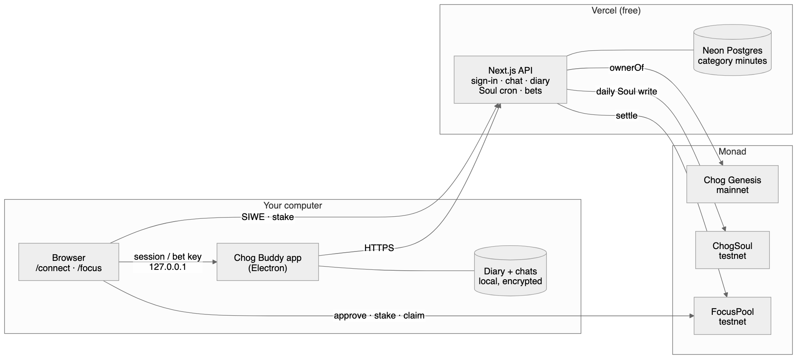
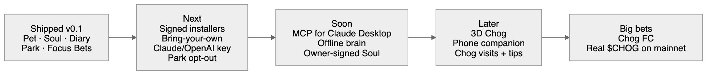

# Chog Buddy

**Your Chog NFT, alive on your desktop.**

Chog Buddy turns a Chog Genesis NFT into a pixel pet that lives on your Mac or Windows screen. It walks along your taskbar, notices what you're doing, talks to you in its own voice, writes a private diary about your day, and grows a public Soul onchain that stays with the Chog forever.

Built for **Chogathon 2026** by Farouk ([@faroukobayanju](https://github.com/faroukobayanju)) and Haikeys ([@haikeysgit](https://github.com/haikeysgit)).

| | |
|---|---|
| **Download** | [Latest release](https://github.com/chog-buddy-team/chog-buddy/releases/latest) (macOS Apple Silicon + Intel, Windows) |
| **Website** | https://chogbuddy.vercel.app |
| **Chog Park** (every active Chog and its Soul) | https://chogbuddy.vercel.app/park |
| **Focus Bets** (start it from the Pet's tray) | https://chogbuddy.vercel.app/focus |

---

## Why it can't work without a Chog

The NFT isn't a skin on top of a generic pet. Take the Chog away and there's nothing left to run.

1. **No Chog, no Pet.** On first launch you sign in with the wallet that holds your Chog. The server checks `ownerOf` on Monad mainnet before your Pet appears. Without a Chog, the only option is **Judge Mode**: a clearly labelled demo Chog (#5). Judge Mode never uploads your data or asks the server for your diary.
2. **The traits are the personality.** Each Chog's onchain traits pick one of five **Archetypes**: Hype Chog, Grump Chog, Lazy Sage, Chaos Chog and Sweetheart. The Archetype sets how the Pet talks, reacts and writes its diary. Two Chogs react differently to the same moment.
3. **"My NFT skin" is yours alone.** One of the outfits is drawn from your Chog's own traits. Its hat and clothes come from the NFT, and its colours are sampled from the NFT image.
4. **The Soul lives onchain, on the token.** Every day your real activity nudges four Soul axes: Night Owl, Grinder, Social and Creator. A daily job writes them, with Level and Owner Count, to the `ChogSoul` contract against the **token ID**. Sell the Chog and its Soul goes with it. The new owner inherits a Chog with a history, but none of your private data.
5. **Losing the Chog ends the relationship.** Ownership is re-checked every 24 hours. If the Chog leaves your wallet, its diary and chat history are wiped from your computer.

## What it does

- **A pet that lives on your screen.**
  - It walks the Dock or taskbar and perches on windows. You can drag it, and click it to poke it.
  - It has a full animation set: idle with blinking, walking, reacting, hopping, sleeping, talking, sad and celebrating.
  - It dozes when you're away.
- **Reactions.** It notices which kind of app you're in (coding, design, chat, browsing, video, meetings), long sessions, late nights and coming back from a break, then comments in a speech bubble.
  - **Focus Mode** makes it scold distractions.
  - Optional **GitHub** (new notifications) and **calendar** (meeting in 5 minutes) triggers.
- **Chat.** Press **Ctrl+Shift+Space**, or click the Chog, and talk to it in its Archetype's voice.
  - It works out of the box through our free server. Free backup models take over if Gemini is busy.
  - Optionally run it fully local with Ollama, or bring your own Gemini key.
  - Chats are saved encrypted, with a history window.
- **Diary.** Every evening the Chog writes about your day, in character. The diary stays on your computer. Past days are in the history window.
- **Skins.** Classic, Hoodie, Jacket, Dress and **My NFT skin**.
- **Soul.** Public, onchain, and tied to the token, as described above.
- **Chog Park.** A public page showing every Chog active this week: its Soul axes and level, a mood line, and today's focus leaderboard.
- **Focus Bets.** Stake test $CHOG on focusing today. Your Chog counts your coding and design time and reports it to the server every 30 seconds. Hit the goal and win your stake plus a bonus. Miss it, and 10% is burned while 90% refills the reward pot. Testnet only, no real money.
- **Export.** Save your Chog's sprite sheet in the Codex/Petdex pet format.

## Try it as a judge

1. Download the installer for your computer from the [latest release](https://github.com/chog-buddy-team/chog-buddy/releases/latest). See the install notes below.
2. Open Chog Buddy. When it asks, pick **Judge Mode (demo Chog)**, or sign in if you hold a Chog.
3. Things to try:
   - Click the Chog to poke it.
   - Press **Ctrl+Shift+Space** and say hi.
   - Open the tray menu: on a Mac, the Chog icon in the menu bar; on Windows, the taskbar tray (click **^** if it's hidden). From there:
     - **Skin** to change outfits.
     - **Today's diary** to read the Chog's day.
     - **Chat history & diary…** for past chats and diaries.
     - **Open Chog Park** to see the public Park page.
     - **Bet on my focus** to stake test $CHOG on your focus (needs a browser wallet on Monad testnet; the bet page links to the faucet).
   - Switch to a code editor for a while, then to YouTube, and watch it react.

### Install notes

The builds are **not code-signed** (signing certificates cost money, and this project runs on a $0 budget; see [ADR 0003](docs/adr/0003-unsigned-installers-no-web-fallback.md)). Your OS will warn you once.

- **macOS, easiest:** paste this into Terminal. It downloads the right build for your Mac into Applications and opens it, with no security prompt:
  ```bash
  curl -fsSL https://raw.githubusercontent.com/chog-buddy-team/chog-buddy/main/scripts/install-mac.sh | bash
  ```
  [Read the script](scripts/install-mac.sh) first if you like. It's 40 lines.
- **macOS, from the DMG** (`Chog-Buddy-<version>-arm64.dmg` for Apple Silicon, `-x64.dmg` for Intel):
  1. Open the DMG and drag **Chog Buddy** into **Applications**. Don't run it from inside the DMG.
  2. Open it once. macOS says *"Chog Buddy" Not Opened*; click **Done**.
  3. Go to System Settings → **Privacy & Security**, scroll to **Security**, and click **Open Anyway** next to Chog Buddy. Confirm with your password.

  Or skip steps 2–3 with one Terminal command:
  ```bash
  xattr -dr com.apple.quarantine "/Applications/Chog Buddy.app"
  ```
  Right-click → Open no longer works on macOS 15 and later.
- **Windows** (`Chog-Buddy-Setup-<version>.exe`): if SmartScreen appears, click **More info**, then **Run anyway**.

The app has no Dock or taskbar button by design; the Pet and its tray icon are the whole app. It needs no screen recording or accessibility permission, because it only reads the **name** of the app in front.

## Privacy

The rule is that **the Soul is public, and the diary never leaves your computer** ([ADR 0001](docs/adr/0001-soul-onchain-diary-local.md)).

- **What leaves your computer:** only minutes per category, for example `coding: 120, video: 45`. These feed the Soul and the Park leaderboard.
- **What never leaves it:** window titles, app names, files and screenshots.
- **Diary and chat history:** stored only on your machine, the chat history encrypted with the OS keychain (`safeStorage`). The server writes the diary text and sends it back, but never stores it.
- **Tokens and keys:** the session token, GitHub token, calendar link and Gemini key are encrypted at rest and never logged.
- **Chat:** chatting through our server or your own Gemini key sends the conversation to Google Gemini, and the tray says so. Choose **Ollama** to keep chat fully on your computer.
- **Chog Park:** shows only the Soul, the Archetype, a mood line and focus minutes. It never shows wallet addresses or diaries.

## How it works



The full explanation is in [docs/ARCHITECTURE.md](docs/ARCHITECTURE.md): the privacy boundary, the daily Soul update, the Focus Bets flow and chat.

- **`packages/core`:** pure, tested logic shared by the app and the server. It covers categorising apps, Archetypes from traits, the Soul drift formula and the pixel sprite kit (canonical Chog, skins, expressions, sprite atlas).
- **`app`:** the Electron Pet. It samples the foreground app every 5 s, keeps today's category minutes and uploads them hourly. It also re-checks ownership daily, runs chat, the diary and reactions, and talks to the browser over a short-lived loopback server for sign-in and Focus Bets.
- **`web`:** the Next.js backend and public pages. It handles SIWE sign-in, `/api/chat` with caps and free backups, `/api/diary`, activity uploads, the daily Soul cron that writes `ChogSoul`, the Focus Bets settlement API, `/park`, `/connect` and `/focus`.
- **`contracts`:** Foundry contracts. `ChogSoul` stores Souls by token ID. `FocusPool` and `MockChog` run Focus Bets.
- **Daily Soul update:** the server is the only writer of the Soul. It applies each day once every timezone has finished that day, so it runs two days behind ([ADR 0002](docs/adr/0002-server-is-sole-soul-writer.md)).

### Onchain

| Network | Contract | Address |
|---|---|---|
| Monad mainnet (143) | Chog Genesis (ERC-721, not ours) | `0xc96d31F8626c6D03Fae5dCD3d61e3FB9F4a73763` |
| Monad testnet (10143) | ChogSoul | `0xf9a7E0172a31235d99e3d93Adf33B36A39279EE4` |
| Monad testnet (10143) | FocusPool | `0x0ae1F74236af4767027ED5e34aFec17D97ec5007` |
| Monad testnet (10143) | MockChog (mCHOG) | `0x2B75E2E55E8F1F982dD7025ff0F8994abFAE176A` |

The Focus Bets contracts are verified on Sourcify. Deployment details are in [contracts/DEPLOYMENTS.md](contracts/DEPLOYMENTS.md).

### Built on $0

| Need | Choice |
|---|---|
| Desktop app | Electron + esbuild |
| Website and API | Next.js on Vercel, free tier |
| Database | Neon Postgres, free tier |
| Chat models | Gemini free tier, with free Groq and OpenRouter backups, or local Ollama |
| Art | Drawn in code: the sprites come from our own pixel kit, with no paid or AI-generated art |

## What's next

The plans are in [docs/ROADMAP.md](docs/ROADMAP.md):
- signed installers
- MCP for Claude Desktop
- an offline brain
- a **3D Chog**
- a phone companion
- Chog visits and tips
- Chog FC
- real $CHOG Focus Bets on mainnet



## Run from source

Requirements: Node 24, plus Foundry if you want the contracts.

```bash
git clone --recurse-submodules https://github.com/chog-buddy-team/chog-buddy && cd chog-buddy
npm install
npm start -w chog-buddy-app        # run the Pet against the live backend
npm test -w @chog/core -w chog-buddy-app -w web
npm run dist -w chog-buddy-app     # build installers into app/release/
```

- Set `CHOG_TOKEN_ID=<id>` to load any Chog without signing in (developer override; it never uploads).
- `CHOG_API_URL` points the app at another backend. The default is the live API.
- `web/.env.example` lists the server's environment variables.
- `web/scripts/fake-pet.mjs` stands in for the Pet when you want to try the bet page on its own.

**Releases:** pushing a `v*` tag runs [`.github/workflows/release.yml`](.github/workflows/release.yml). It tests, builds the macOS and Windows installers on GitHub's runners, and publishes them to Releases.

## Repo map

```
app/         Electron Pet (main process, renderer, tests)
web/         Next.js API + /, /connect, /focus, /park
packages/    @chog/core: shared logic and the pixel sprite kit
contracts/   Foundry: ChogSoul, FocusPool, MockChog
docs/        ARCHITECTURE.md, ROADMAP.md, diagrams/, adr/ (decisions and why)
CONTEXT.md   Shared vocabulary (Chog, Pet, Soul, Archetype, Activity…)
```

The design system for the web pages (the sticker-sheet look) is described in [web/DESIGN.md](web/DESIGN.md).
