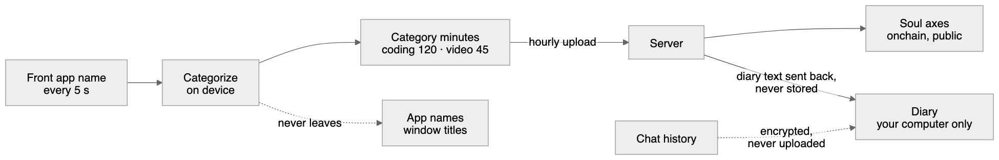
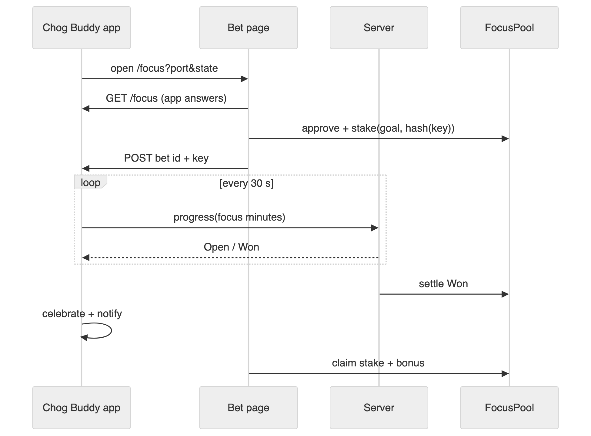

# How Chog Buddy works

Chog Buddy has three parts that talk to each other: a desktop app, a small web backend, and contracts on Monad. This page explains how they fit, what data moves where, and why it's built this way. For setup and commands, see the [README](../README.md).

Source: [diagrams/architecture.mmd](diagrams/architecture.mmd), editable as [architecture.excalidraw](diagrams/architecture.excalidraw)

## The parts

| Part | Where | What it does |
|---|---|---|
| **Pet app** (`app/`) | Your computer (Electron, Mac + Windows) | Draws the pixel Chog, watches which kind of app is in front, chats, writes the Diary, reports Focus Bets and syncs category minutes. |
| **Shared core** (`packages/core`) | Inside both the app and the server | The pure logic both sides must agree on: categorising apps, picking the Archetype from traits, the Soul drift formula, and the pixel sprite kit. |
| **Web backend** (`web/`) | Vercel free tier + Neon Postgres | Wallet sign-in (SIWE), ownership checks, chat and diary generation, activity uploads, the daily Soul writer, Focus Bets settlement, and the public pages `/`, `/connect`, `/focus` and `/park`. |
| **Contracts** (`contracts/`) | Monad | `ChogSoul` stores each token's Soul. `FocusPool` and `MockChog` run Focus Bets. Chog Genesis itself is the existing NFT on mainnet; we only read it. |

## The privacy boundary

The hard rule is that **the Soul is public, and the Diary never leaves your computer** ([ADR 0001](adr/0001-soul-onchain-diary-local.md)).

Source: [diagrams/privacy-boundary.mmd](diagrams/privacy-boundary.mmd)

1. Every 5 seconds the app reads only the **name** of the app in front. It needs no screen recording and no accessibility permission.
2. It turns that name into a category on your machine: coding, design, chat, browsing, video, meetings, idle or other. The name itself is never stored or sent.
3. Only the **minutes per category** are uploaded, once an hour.
4. The server uses those minutes to nudge the Soul's four axes (Night Owl, Grinder, Social, Creator) and writes them onchain once a day.
5. Diary text is generated by the server and sent straight back, never saved there. The app stores it locally. Chat history is encrypted with the OS keychain and never uploaded.

**Trade-off:** coarse minutes make the Soul less precise than full activity logs would. But a public, permanent, transferable record must never contain someone's private life, so precision loses.

## Why the NFT is essential

- **Gate:** the server checks `ownerOf` on Chog Genesis (Monad mainnet) at sign-in and every 24 hours after. No Chog means no Pet. Judge Mode is the one labelled exception, a demo Chog.
- **Identity:** the Archetype (how the Chog talks and reacts) is derived from the token's traits, and so is **My NFT skin**.
- **Memory:** the Soul is stored on `ChogSoul` against the **token ID**, so it moves with the NFT when it's sold. The new owner gets the Chog's history but none of the old owner's Diary, which is wiped from their computer when the Chog leaves the wallet.

## The daily Soul update

The server is the only writer of the Soul ([ADR 0002](adr/0002-server-is-sole-soul-writer.md)).

- **Timing:** a cron job runs daily at 00:10 UTC. A GitHub Actions backup runs at 00:40 UTC in case Vercel's cron misses. It applies each day only once every timezone has finished that day, so it runs two days behind.
- **Limits:** drift is capped per day, so no single day can swing a Soul.
- **Cost:** updates are batched into one transaction for many Chogs, which keeps gas low and lets owners skip signing anything.

**Trade-off:** owners trust the server to write honestly. Owner co-signed updates are on the [roadmap](ROADMAP.md).

## Focus Bets

Source: [diagrams/focus-bets.mmd](diagrams/focus-bets.mmd)

1. **Tray → Bet on my focus** starts a tiny server on `127.0.0.1` and opens the bet page with that port and a random 32-character state.
2. The page checks that the app answers, then the user approves and stakes. The stake carries only the **hash** of a fresh secret key.
3. The page hands the bet ID and key to the app over loopback. The key is stored encrypted.
4. Every 30 seconds the app reports coding and design minutes since the stake. The server only lets focus grow as fast as real time, with at most 2 minutes of banked credit. So a fake jump at the end wins nothing, and a win needs reports through the whole bet.
5. When the goal is reached, the server settles **Won** onchain. The Chog celebrates and the user claims their stake plus a bonus. If time runs out, the bet is **Lost**: 10% is burned and 90% refills the reward pot.

## Chat

- **Order:** Auto mode tries our server first (free, no key), then Ollama (fully local), then the owner's own Gemini key.
- **Fallback:** the server uses the Gemini free tier, then free backups on Groq and OpenRouter, then an in-character fallback line.
- **Caps:** daily caps per caller and overall protect the shared quota.
- **Persona:** the Chog's persona is built on the server from its real traits, so a client can't impersonate another Chog's voice.

## Loopback hand-offs

Sign-in (`/connect`) and Focus Bets both use the same pattern to pass a secret from a web page to the desktop app.

- **Binding:** a short-lived HTTP server on `127.0.0.1`, never all interfaces.
- **State:** a random 32-character state that the page must echo.
- **CORS:** only our site origins are allowed, plus the private-network header Chrome asks for.
- **Limits:** the same body-size and timeout limits on both.

Secrets go only in POST bodies, never in URLs or logs.

## Decisions on record

- [ADR 0001](adr/0001-soul-onchain-diary-local.md): Soul onchain, Diary local
- [ADR 0002](adr/0002-server-is-sole-soul-writer.md): the server is the only Soul writer
- [ADR 0003](adr/0003-unsigned-installers-no-web-fallback.md): unsigned installers, no web-only fallback
- [ADR 0004](adr/0004-pixel-sprite-kit-with-real-nft-face.md): the pixel sprite kit (partly superseded)
- [ADR 0005](adr/0005-canonical-chog-skins.md): one canonical Chog with skins
- [CONTEXT.md](../CONTEXT.md): shared vocabulary
